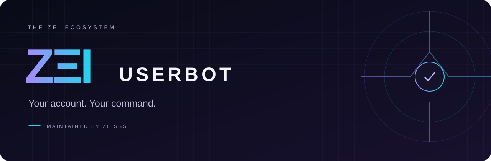

<div align="center">



### Akunmu. Perintahmu. Cara kerjamu.

Bagian dari ekosistem ZΞI Project


[](LICENSE)

[**Hubungkan akun ↓**](#mulai) · [**Daftar fitur ↓**](#fitur) · [**ZEI Gate ↗**](https://github.com/H3llnn/ZEI-Gate)

</div>

---

## Kendali dari akunmu sendiri

**ZΞI Userbot** adalah runtime akun Telegram pribadi untuk pengguna yang mendapat izin melalui Gate. Satu akun per pengguna; nama dan identitas tetap mengikuti akun Telegram pemiliknya.

```text
.help          Buka bantuan
.ping          Periksa respons
.prefix !      Ganti awalan perintah
```

| | |
| :--- | :--- |
| **⚡ 38 perintah** | Catatan, pesan, profil, administrasi grup, utilitas, dan otomatisasi. |
| **🎛️ Prefix pilihanmu** | Atur awalan dari akun sendiri atau bot induk. |
| **🔐 Sesi terenkripsi** | OTP dan password 2FA tidak disimpan di database. |
| **🛡️ Kendali pemilik** | Perintah diterima dari akun pemilik; tindakan admin memerlukan hak Telegram yang sesuai. |

> **Status pengembangan:** 5 tes otomatis Userbot lulus pada pemeriksaan lokal. Login akun dan hak grup pada instalasi terbaru masih perlu diuji langsung. [Status ekosistem](https://github.com/H3llnn/ZEI-Gate/blob/main/docs/STATUS.md).


## Mulai

Letakkan folder ZEI-Gate dan ZEI-Userbot berdampingan. Jalankan python install.py dari folder Gate.
Buka ruang pembuatan melalui bot induk, isi API ID/Hash, lalu hubungkan akun sendiri melalui nomor, OTP dan 2FA bila diperlukan.

Ketik .help dari akunmu untuk membuka bantuan. Gunakan .prefix ! untuk mengganti prefix,
atau buka Pengaturan Prefix melalui bot induk. Prefix dan catatan tetap disimpan saat koneksi ulang.

## Fitur

- Kendali akun: help, ping, id, status, prefix.
- Catatan: save, notes, get, delnote.
- Pesan: say, purge maksimal 100 pesan sendiri, afk, unafk.
- Profil: whois, setname, setbio, stats.
- Grup: ban, unban, kick, pin, unpin, promote, demote, invite, title, chatinfo.
- Utilitas: hash, time, calc, getlink.
- Otomatisasi: filter, filters, delfilter, welcome, pmpermit, approve, disapprove.

Perintah hanya menerima pesan keluar dari ID pemilik akun. Perintah admin tetap membutuhkan hak Telegram yang sesuai.
PMpermit memberi pemberitahuan tanpa memblokir orang otomatis. AFK dan filter memiliki jeda balasan.

## Akses dan sesi

Izin dikelola pemilik bot induk dan berlaku sampai dicabut. Pencabutan menghentikan Userbot;
setelah izin pulih, pemilik menghubungkan ulang. Sesi tersimpan terenkripsi di server pengelola.
Jalankan hanya di server yang kamu percaya. OTP dan password 2FA tidak disimpan dalam database.

## Pengujian

```sh
python -m pip install .
python -m unittest discover -s tests -v
```

Daftar di atas merupakan fitur yang tersedia pada versi ini. Login dan hak grup nyata diuji melalui akun pemilik,
sementara tes otomatis menggunakan objek Telegram tiruan. Detail sumber dan lisensi tersedia di THIRD_PARTY_NOTICES.md dan LICENSE.

---

<div align="center">

**ZΞI PROJECT** · Maintained by **Zeisss**

Built around your Telegram workflow.

</div>
